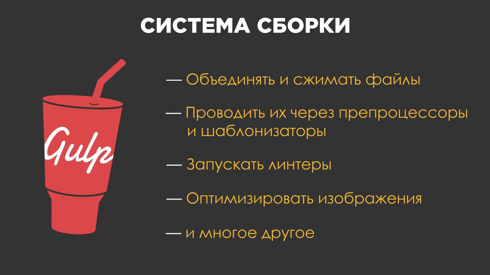
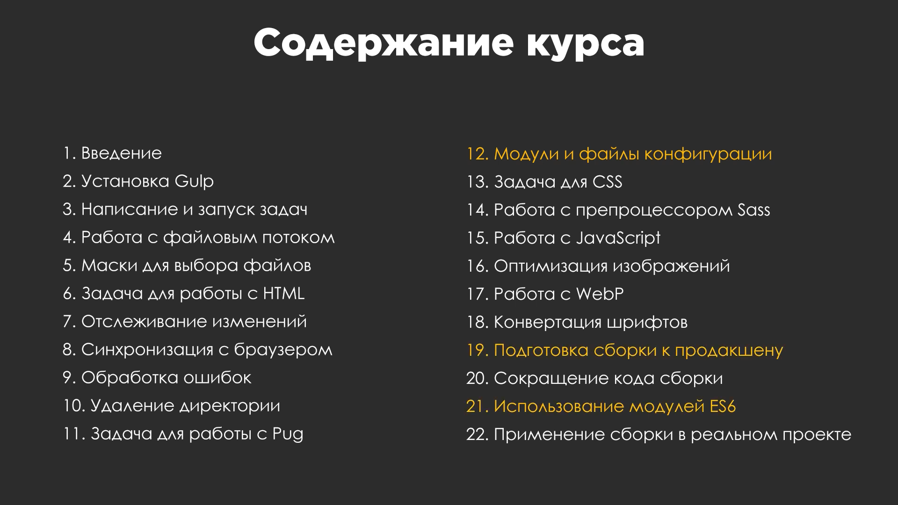
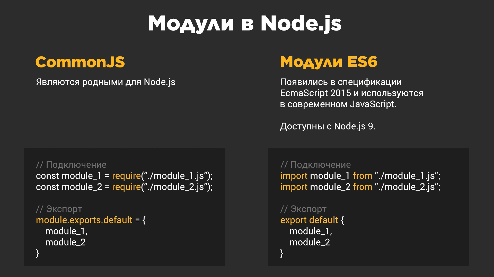
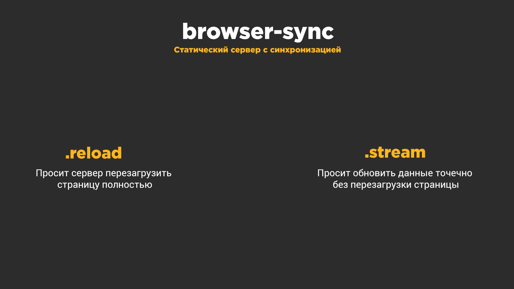
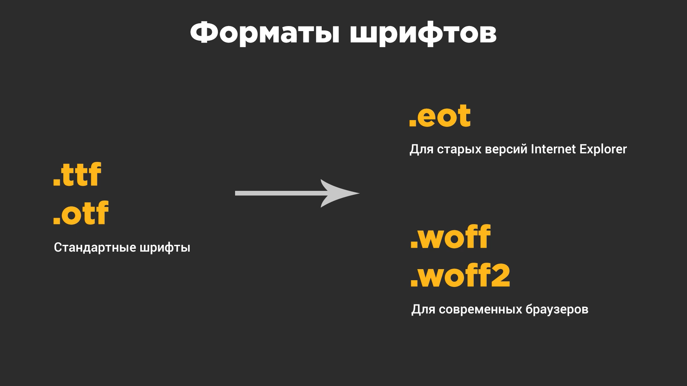

# codeQuest

**Credits & acknowledgments**

This project was coded line-by-line for practice and learning purposes, following the tutorial by [CodeQuest](https://www.youtube.com/@CodeQuestRu).

## gulp-2021-base/-ES6/-short

**Tutorial video:** [YouTube](https://www.youtube.com/watch?v=qSZvGlIKGPg)

